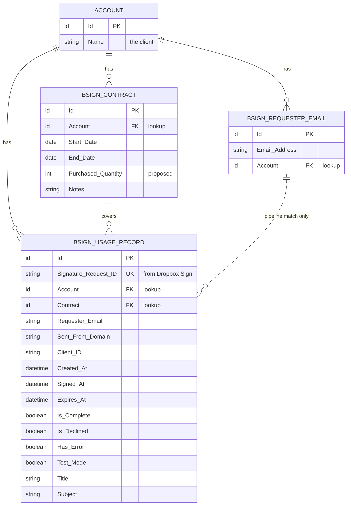

# bSign Reporting ERD (draft)

Source: 10/19/2026 check-in (Christian's proposed model) plus the columns kept from `dbo.signature_requests_raw`.
Renders on GitHub, in VS Code preview, or by pasting the block into mermaid.live.

## Reading it

- Each box is an object (a table). The fork end of a line is the "many" side, and that side holds the lookup field.
- The dashed line means no lookup exists. The pipeline uses the Requester Email table to find the Account, then sets the Account lookup on the usage record.
- `Purchased_Quantity` is proposed (not in the 10/19 field list). Needed to compare usage to what was bought.
- Open decision: custom bSign Contract object vs. the standard Salesforce Contract with a Type field.
